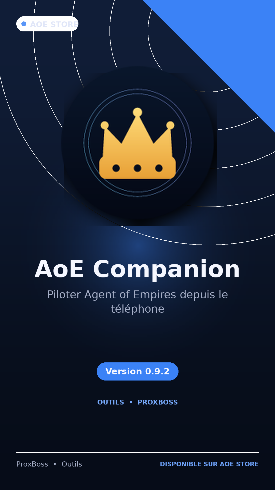
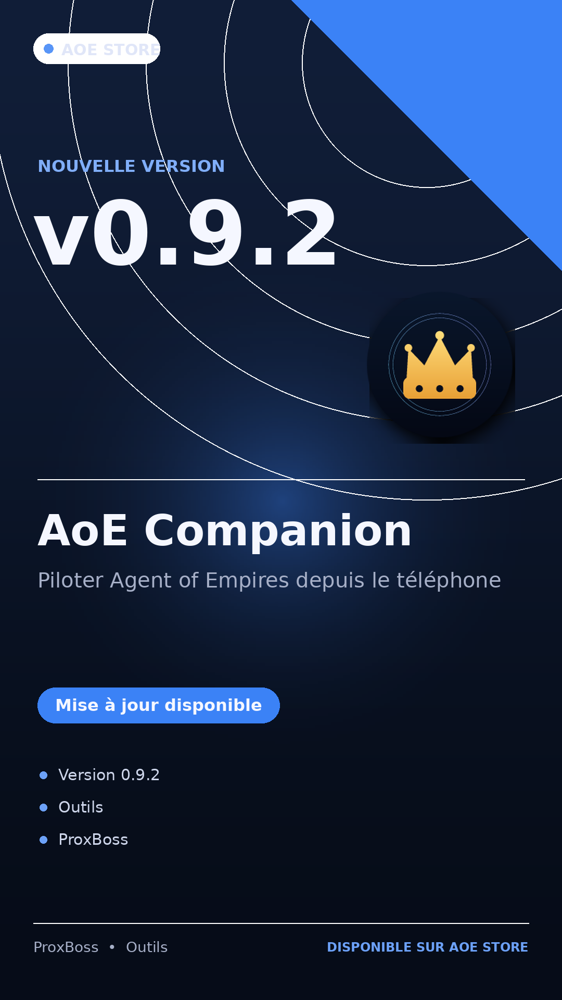
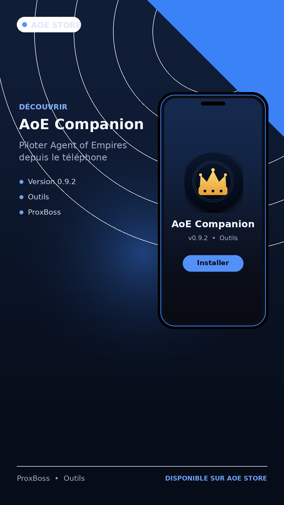

# AoE Companion

Application Android pour piloter une instance **Agent of Empires (AoE)** depuis
un téléphone. Elle reprend l'essentiel du dashboard web dans une interface
mobile pensée pour le quotidien : suivre ses sessions, lire les transcripts en
direct, approuver les actions de l'agent et recevoir des notifications.

## Fonctionnalités

- **Liste des sessions** par projets, avec favoris, groupes, recherche,
  compteurs et états agrégés.
- **Transcript live** des sessions structurées (ACP) : markdown, outils
  repliables, diffs, pièces jointes et bascule vers la vue terminal.
- **Approbations** directement depuis le téléphone : accepter, toujours
  accepter ou refuser une action de l'agent.
- **Notifications** pour les sessions en attente, en erreur ou inactives, avec
  actions rapides et plage silencieuse.
- **Création de session** : dossier, agent, modèle, effort, groupe, worktree,
  branche et options de lancement.
- **Gestion du serveur** : MCP, skills, plugins, profils, sécurité, logs et
  mises à jour.
- **Diff et terminal** : consultation des fichiers modifiés et envoi de texte
  dans le terminal de la session.

## Captures

<p>
  
  
  
</p>

## Installation

L'application est distribuée sous forme d'APK dans les
[releases GitHub](https://github.com/AlexandrLebegue/aoe-companion/releases).

1. Télécharger le fichier `app-debug.apk` de la dernière release.
2. Autoriser l'installation depuis une source inconnue si Android le demande.
3. Ouvrir l'APK pour installer l'application.

Installation par ADB :

```sh
adb install -r app-debug.apk
```

## Configuration

Au premier lancement, l'écran de connexion demande :

- **URL du serveur** : adresse de votre instance AoE, par exemple
  `http://adresse-du-serveur:8080`.
- **Jeton** : fourni par votre instance Agent of Empires (fichier
  `serve.token` de l'instance, ou serveur lancé avec `--no-auth`).

Le bouton **Tester** interroge `GET /api/about` et affiche la version, le mode
d'authentification et le profil servi. La configuration est conservée dans
DataStore. Le bouton **Se déconnecter** efface le jeton et ramène à cet écran.

Le HTTP en clair est activé pour le réseau local. Le jeton n'est jamais écrit
dans les logs de l'application.

## Compilation

Prérequis : JDK 17 ou supérieur, Android SDK 35 et les outils Android en ligne
de commande. Renseignez `ANDROID_HOME` vers votre SDK.

```sh
./gradlew assembleDebug
```

APK généré : `app/build/outputs/apk/debug/app-debug.apk`.

Tests unitaires :

```sh
./gradlew testDebugUnitTest
```

## Architecture

- Kotlin + Jetpack Compose Material3, module `:app`
- OkHttp pour HTTP et WebSocket
- DataStore Preferences pour la configuration et les états locaux
- ViewModel + StateFlow
- Parsing JSON via `org.json`
- Aucune dépendance Hilt, Room ou équivalent

## Limites connues

- Le modèle affiché dans la liste provient d'un cache local alimenté par ACP ;
  `/api/sessions` ne l'expose pas.
- Certaines routes récentes n'existent pas sur les anciens daemons (1.20) :
  l'app affiche alors un message ou utilise un repli.
- Les notifications utilisent le WebSocket local et un service Android, pas
  Web Push. Sans redémarrage automatique au boot, aucune alerte n'arrive après
  un redémarrage du téléphone tant que l'app n'est pas ouverte.
- Pas de WebAuthn/passkey depuis l'app, pas d'import/fork de session, sandbox,
  multi-repo, commentaires de diff, file de prompts avec pièces jointes
  binaires, cartes d'outils spécialisées, agents d'arrière-plan, sons, ni
  gestion des workspaces/projets/templates.
